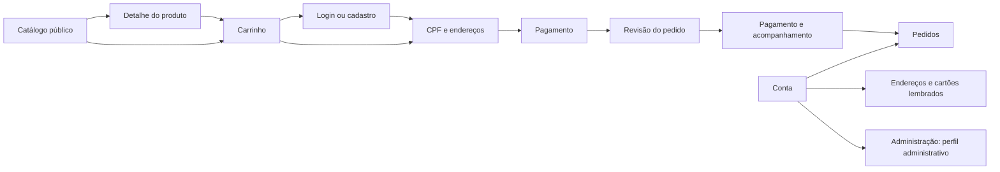

# VendEletro — fluxos, telas e estados

Fonte: Histórias de Usuário (INVEST) — VendEletro, 22/10/2026.

## Hierarquia e navegação

O catálogo é a entrada pública. Cabeçalho com busca, categorias, conta e carrinho; acesso aos pedidos e administração pelo menu/rodapé. O checkout exige autenticação, preservando o carrinho. Retorno a etapas anteriores ocorre pelos controles de cada formulário. URLs com hash permitem recarregar páginas sem configuração adicional de servidor.

## Rastreabilidade

| Histórias | Tela / URL | Interações e estados |
| --- | --- | --- |
| US-01 | Catálogo `#catalog` e diálogo de produto | Busca livre, três categorias, ordenação, detalhes; mensagem sem resultados e limpeza de filtros |
| US-02 | Carrinho `#cart` | Adicionar, alterar quantidades, remover; totais imediatos, estado vazio e confirmação por toast |
| US-03–04 | Acesso `#auth` | Login, cadastro, dados obrigatórios, nascimento opcional, senha divergente, e-mail duplicado, erro de credenciais; retorno ao checkout com carrinho preservado |
| US-05 | Conta `#account` e checkout | Cadastro de endereço com complemento opcional, endereço salvo preenchido no checkout |
| US-06–07 | Etapa 1 `#checkout` | CPF com dígitos verificadores, entrega e cobrança iguais por padrão, formulário alternativo de cobrança |
| US-08–10 | Etapa 2 `#checkout` | Crédito 1–10x, bandeiras por modalidade, débito sem parcelas, CVV obrigatório, cartão lembrado apenas por bandeira/final, remoção na conta |
| US-11 | PIX `#order/:id` | Desconto, código ilustrativo, cópia, contagem de prazo, expiração, revalidação dos preços na renovação, confirmação simulada |
| US-12 | Boleto `#order/:id` | Linha demonstrativa, 3 dias úteis para vencer, pendente, simulação de compensação e cancelamento |
| US-13 | Etapa 3 `#checkout` | Resumo de produtos, subtotal, frete, desconto e total; uma modalidade por pedido |
| US-14 | Administração `#admin` | Acesso por perfil demonstrativo, descontos, limiar e expiração; validação numérica e toast de sucesso |

## Direção visual e responsividade

Identidade com verde floresta, sálvia, fundo marfim e tipografia do sistema. Ilustrações SVG locais, sem dependência de imagens externas. Tokens de cor, bordas e espaçamento e componentes compartilhados de botões, painéis, formulários, resumo, feedback e diálogos em `src/style.css`.

Catálogo com 4, 3 ou 2 colunas conforme largura. Carrinho e checkout com resumo lateral em desktop e abaixo do conteúdo no celular. Cabeçalho reorganiza a busca em uma linha própria. Formulários identificados por rótulos, foco visível, mensagens de erro, regiões de status e suporte a movimento reduzido.

## Estados

- Vazio: busca, carrinho, endereços, cartões e pedidos.
- Carregamento: envio do pedido com indicador e botão desabilitado.
- Erro: validação nativa dos campos, CPF inválido, senhas divergentes, e-mail duplicado, acesso negado, credenciais incorretas, bandeira não aceita, cartão vencido e recusa simulada sem perder o carrinho.
- Sucesso: cadastro/login, atualização de carrinho, endereço/configurações salvos e pedido/pagamento confirmado.
- Pendente/expirado: PIX com prazo e renovação; boleto com vencimento, compensação ou cancelamento.

## Decisões e limites

O incremento atual implementa backend real de catálogo e carrinho; consulte [contrato e arquitetura](backend.md). Os demais fluxos são protótipos locais de interface. Autenticação e autorização são demonstrativas e não constituem segurança de produção. Use exclusivamente dados fictícios. Dados de contas, endereços, cartões e pedidos demonstrativos ficam no navegador; endereços e metadados de cartão são separados por e-mail. Produtos e carrinho ficam no SQLite do servidor; o carrinho é identificado por cookie de visitante.

Desconto PIX inicial de 5% e expiração inicial de 15 minutos são decisões demonstrativas editáveis: a SRS não fixa esses valores. Débito e boleto iniciam com 0%; limiar 3D Secure com R$ 1.500. Frete gratuito é demonstrativo, pois o documento não especifica o cálculo. O cálculo de dias úteis ignora feriados por ausência de calendário definido.

QR/linha são deliberadamente ilustrativos e não pagáveis. Número completo e CVV não são gravados: apenas bandeira e quatro últimos dígitos. Não há token de PSP real; compras reais com cartões salvos dependem da integração. Aprovação, recusa, 3D Secure e compensação são simulações explícitas. HT-02–07 (lojas mobile, TLS de produção, tokenização, banco/3DS, antifraude e gateway) exigem implementação e infraestrutura externas. A busca local não equivale ao teste de carga de HT-01. NF-e e reserva de estoque não são emitidas/executadas.

## Validação realizada

`npm test`: 4 testes aprovados (CPF, totais/modalidades, dias úteis, bandeiras). `npm run check`: sintaxe aprovada. `npm run dev`: servidor iniciou na porta 5173. A conexão HTTP de verificação foi impedida pelo ambiente (`Operation not permitted`); o navegador Chrome/Playwright foi encerrado na inicialização. Assim, validação visual e de interações em navegador permanece pendente.

## Roteiro de validação no navegador

1. Abrir em desktop (1440 px), tablet (768 px) e celular (390 px). Conferir ausência de rolagem horizontal, foco por teclado e leitura dos formulários.
2. Buscar produto inexistente e limpar busca. Filtrar cada categoria. Abrir detalhe e adicionar produto.
3. Alterar quantidade, remover item e testar carrinho vazio. Adicionar novamente e finalizar sem login.
4. Entrar como `cliente@demo.com` / `Demo1234`; conferir preservação do carrinho. Testar cadastro com nascimento vazio, senhas divergentes e e-mail duplicado.
5. Testar CPF inválido e CPF fictício válido `529.982.247-25`. Preencher endereço e alternar cobrança diferente.
6. Trocar entre PIX, crédito, débito e boleto; conferir descontos, parcelas 1–10 e ausência de parcelas no débito. Usar cartão fictício `4111111111111111`, validade futura e CVV fictício.
7. Revisar, confirmar e observar carregamento. No cartão, simular recusa e tentar novamente; no crédito de alto valor, simular 3DS. Salvar metadados, reutilizar com novo CVV e remover na conta.
8. No PIX, copiar código demonstrativo, aguardar expiração (configurar 1 minuto), renovar e simular liquidação. No boleto, conferir vencimento e simular compensação/cancelamento.
9. Entrar como `admin@demo.com` / `Demo1234`, alterar parâmetros e conferir aplicação em novos pedidos. Como cliente, confirmar acesso negado a `#admin`.
10. Recarregar, conferir persistência do carrinho/pedidos e isolamento de endereços/cartões ao trocar de conta.
